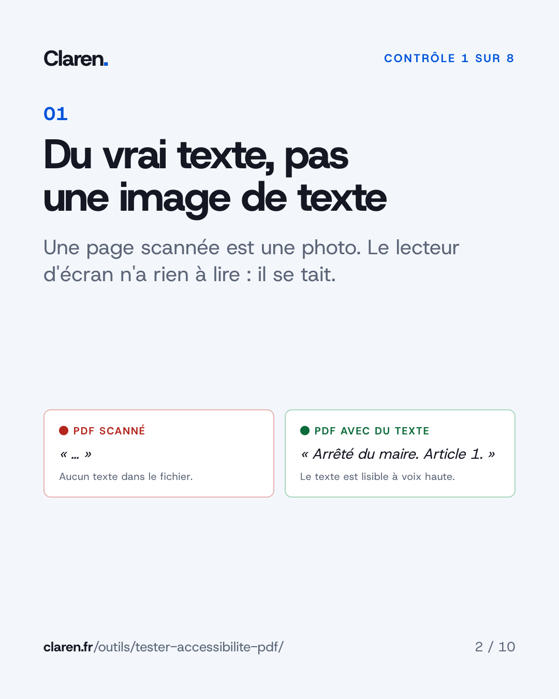
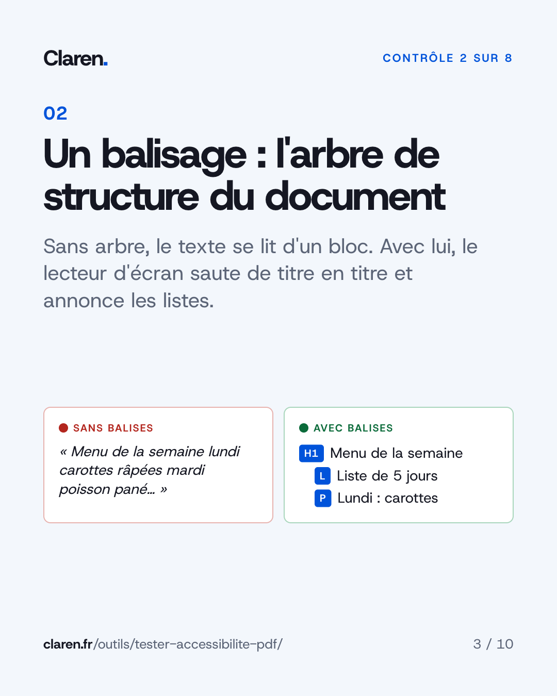
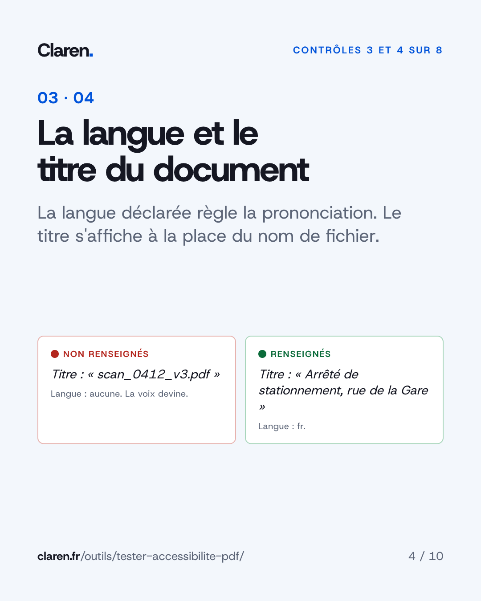
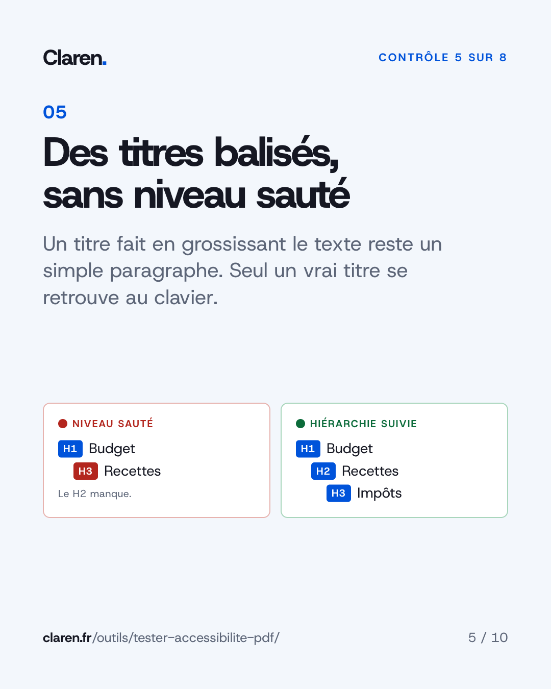
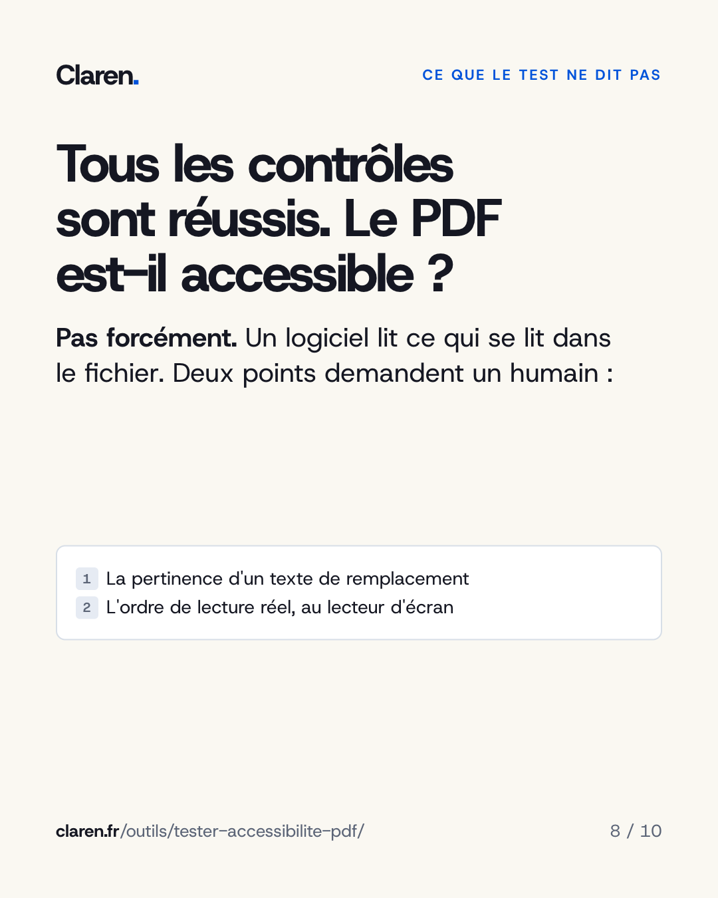

# Checklist : un PDF est-il lisible par un lecteur d'écran ?

Checklist ouverte (CC BY 4.0) pour contrôler un PDF avant de le publier. Elle sépare ce qu'un logiciel peut
vérifier de ce qui demande un humain.

## Ce qu'un logiciel peut vérifier

- [ ] Du vrai texte (pas une page scannée en image)
- [ ] Un balisage (arbre de structure)
- [ ] La langue déclarée
- [ ] Le titre du document, affiché à la place du nom de fichier
- [ ] Des titres balisés, sans niveau sauté
- [ ] Des images avec un texte de remplacement
- [ ] Des tableaux avec des cellules d'en-tête
- [ ] La norme PDF/UA déclarée dans les métadonnées

## Ce qui demande un humain

- [ ] Le texte de remplacement décrit-il vraiment l'image ?
- [ ] L'ordre de lecture est-il le bon ? (passe au lecteur d'écran : NVDA avec Firefox sous Windows, VoiceOver sous macOS et iOS)
- [ ] Les liens disent-ils où ils mènent ?

## Corriger à la source
Un PDF hérite de la structure du fichier qui l'a produit : styles de titre dans Word ou LibreOffice, vraies listes,
tableaux avec ligne d'en-tête, puis export avec les balises. Méthode détaillée : https://claren.fr/blog/rendre-pdf-accessible/
La checklist de la DINUM pour un PDF issu d'un traitement de texte : https://design.numerique.gouv.fr/outils/checklist-pdf

## Tester un PDF
Test gratuit en ligne (un document par jour, fichier analysé puis oublié) : https://claren.fr/outils/tester-accessibilite-pdf/
Il fait les huit contrôles de la première liste. Il ne remplace pas la seconde.

## Pour une commune
Critère 13.3 du RGAA, exemption des fichiers publiés avant le 23 septembre 2018 : https://claren.fr/blog/pdf-accessible-mairie/

Licence : CC BY 4.0. Auteur : Théodis Guyon, Claren.
